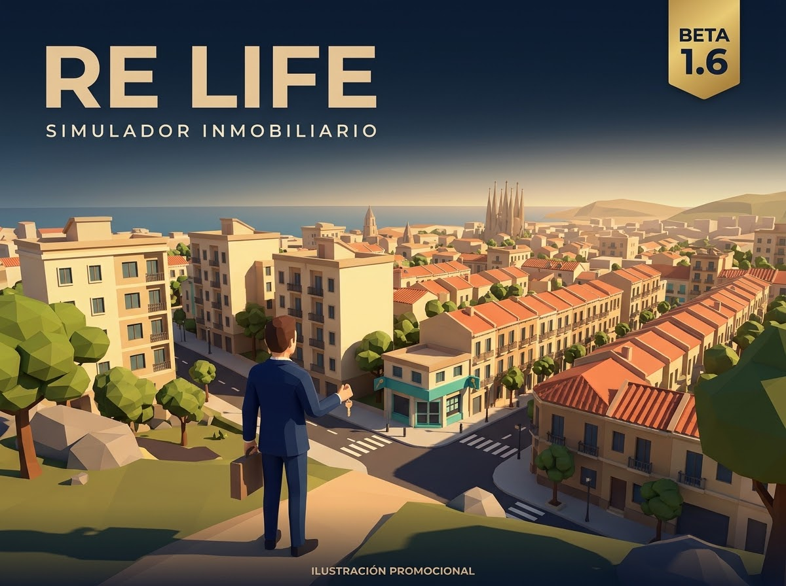

# Barcelona Real Estate Life (RE Life)

*Ilustración promocional, no es una captura del juego.*

Simulador 3D de agente inmobiliario en Barcelona: visitas, ventas, comisiones y ascenso a Senior. Versión 1.6 beta, con datos ficticios.

Juega gratis en el navegador: https://vendopor.com/re-life-beta/

## Qué contiene este repositorio

- `index.html`: el juego completo en un solo archivo, tal como está publicado en vendopor.com. Se abre en cualquier navegador moderno, sin servidor ni instalación.
- `cover.png`: ilustración promocional.
- `LICENCIAS.txt` y `licencias/`: créditos y licencias de terceros (three.js, React y scheduler, MIT; modelo CesiumMan, CC BY 4.0; materiales CC0).

## Notas

- Es una beta con datos de demostración. Los honorarios del 5 % y los 3 días hasta el cobro son supuestos del simulador.
- Para conservar una partida usa Guardar y guarda el código fuera del juego; puedes restaurarlo desde la pantalla de inicio.
- `app/`: código fuente completo (React, three.js, Vite, pnpm). Ver `app/README.md` para compilarlo. La compilación independiente tiene marco y estilos propios y no equivale byte a byte al `index.html` publicado.
- Licencia del código de RE Life: pendiente de decidir por su autor. Sin licencia explícita, todos los derechos quedan reservados. Las licencias de terceros se mantienen tal como figuran en `LICENCIAS.txt`.

Autor: VENDOPOR (https://vendopor.com)
